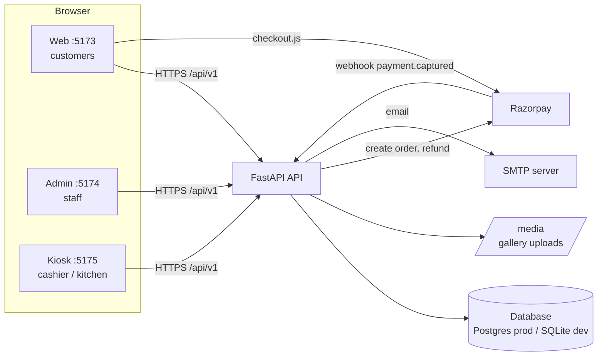
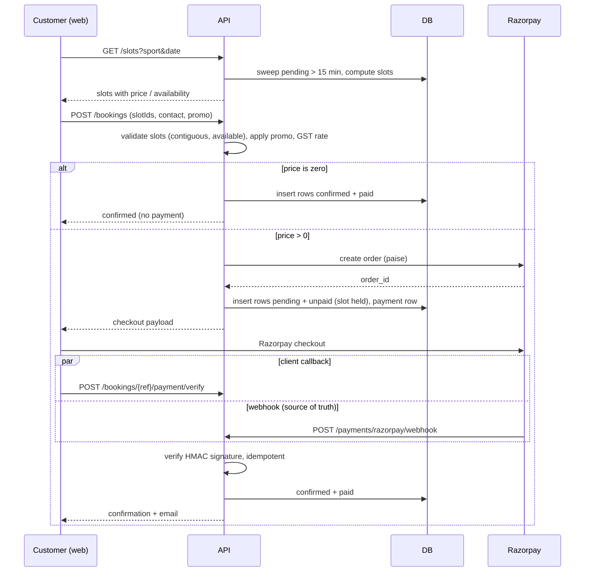
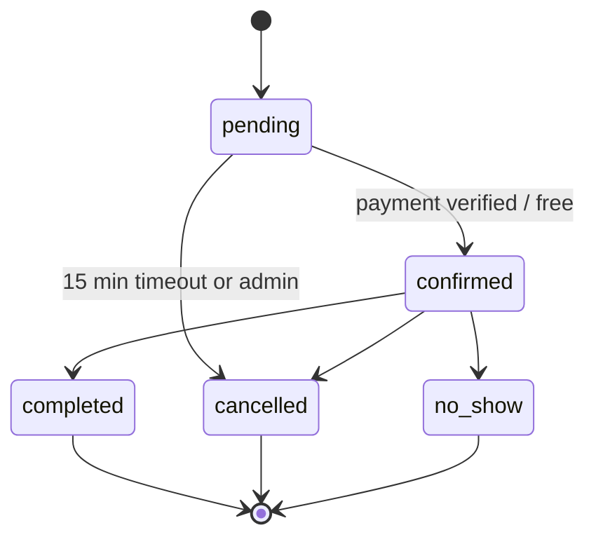
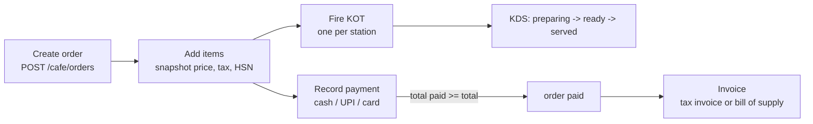

# Dazy Club — App Overview

One-document guide to the whole platform: what it does, how each flow works, the tech stack, how it is developed and deployed, and every environment/config variable.

> Source of truth is the code. Where this doc and older docs disagree (e.g. README says React 18; code uses React 19), trust the code. Details such as field-level API schemas live in [API-Reference.md](API-Reference.md).

---

## 1. What Dazy Club is

A sports-venue operating system for **Cricket, Badminton and Pickleball**, plus an in-venue **café**. It has four deployable parts:

| App | Path | Dev port | Users | Purpose |
|---|---|---|---|---|
| Web | `apps/web` | 5173 | Customers (no login) | Browse, book and pay for slots, enquiries, café pre-order |
| Admin | `apps/admin` | 5174 | Admin / manager | Back-office: bookings, schedule, content, café setup, users |
| Kiosk | `apps/kiosk` | 5175 | Cashier / kitchen (PIN) | Café POS billing, GST invoices, kitchen display (KDS) |
| API | `apps/api` | 8000 | All of the above | FastAPI backend, database, payments, notifications |

### Roles

| Role | How created | Login | Can do |
|---|---|---|---|
| Customer | none | none — identified by booking ref + phone/email | Book, pay, look up own bookings, pre-order café items |
| Superadmin (`admin`) | `ADMIN_USERNAME` / `ADMIN_PASSWORD` env vars | username + password, JWT 8 h | Everything, incl. user management |
| Manager | Admin → Users | username + password, JWT 8 h | Everything except user management |
| Cashier | Admin → Users | staff name + 4-digit PIN (kiosk), JWT 2 h | Kiosk POS |
| Kitchen | Admin → Users | staff name + 4-digit PIN (kiosk), JWT 2 h | Kiosk (same permissions as cashier today) |

Kiosk (cashier/kitchen) tokens are rejected on every `/admin/*` route (403), and kiosk staff cannot sign in at `/admin/login`; only `admin` and `manager` reach the back office.

---

## 2. Architecture



Key design points:

- Three independent static React SPAs share one API (`VITE_API_BASE_URL`).
- **Slots are not stored.** They are computed from schedule rules and exceptions, minus existing bookings.
- A booking is stored as **one row per slot**, all sharing a `bookingRef`. A partial unique index `uq_active_court_slot` on `(court_id, slotId)` (where status is not cancelled/no_show) is the hard double-booking guard.
- Repositories are named `Sqlite*Repository` for historical reasons; they run on any SQLAlchemy URL.
- On startup the API runs `alembic upgrade head` then seeds demo data if the DB is empty. There is no separate migrate step.
- No in-process worker exists. Stale pending bookings are swept lazily whenever slots are read, and on a schedule when an external cron calls `POST /internal/sweep` (expiry + payment reconciliation; see section 6).

---

## 3. Features by app

### 3.1 Customer web (`apps/web`)

All pages are public.

| Route | Feature |
|---|---|
| `/` | Hero, stats, sport cards, "how it works", gallery carousel (from CMS), testimonials, corporate-events CTA, FAQ |
| `/book` | Pick sport (tabs) and one of the next 7 days; optional court filter; live slot grid with price, discount and "Booked" tags; select **consecutive** slots (up to 8); enter name, phone/email, players, message; live promo validation; pay |
| `/my-bookings` | Look up by booking ref, phone/email, or both. Ref + contact on a pending booking resumes payment. Confirmed bookings show the paid amount and the café pre-order panel |
| `/contact` | General enquiry and corporate enquiry (company, group size, event type, date, sport), plus venue details from CMS |

Other: floating WhatsApp button, Razorpay checkout loaded dynamically, simulated-payment buttons when provider is `noop`, café pre-order panel on a confirmed booking.

There is **no customer cancel**. A pending booking auto-expires after 15 minutes; cancel and refund are admin-only.

### 3.2 Admin back-office (`apps/admin`)

Login at `/login`, then:

| Page | Feature |
|---|---|
| Dashboard | Bookings and revenue today, café revenue, occupancy, pending bookings, new enquiries, day-close table (café payments by cash/UPI/card) |
| Bookings | List, filter, sort, export; confirm / complete / no-show / cancel; refund; delete |
| Schedule | Weekly open/close rules per court (slot length, price, discount) and date exceptions (holiday, special hours; venue-wide or per court) |
| Courts | Court CRUD. One court = one booking per slot; add more courts for parallel play (capacity is fixed at 1) |
| Promos | Percent or flat codes, date window, max uses, sport restriction |
| Enquiries | Triage contact and corporate enquiries (new / handled) |
| Gallery | CRUD with image upload (jpg/png/webp/gif, 10 MB, magic-byte check) |
| Testimonials, CMS, Contact details | Public content and venue info (including `booking_gst_rate`) |
| Users | Create managers, cashiers, kitchen staff (superadmin only) |
| Café | Categories, items (GST rate, HSN, station), tables, settings (GSTIN, invoice series), orders (read-only) |

### 3.3 Kiosk (`apps/kiosk`)

| Route | Feature |
|---|---|
| `/login` | Staff name + 4-digit PIN pad |
| `/menu` | Category rail, item grid, cart; place order; pay by cash, UPI or card (round-off shown); GST invoice with 80 mm thermal print |
| `/orders` | Open and history tabs, pay action, "Pre-order" badge for web pre-orders, 15 s auto-refresh |
| `/tables` | Table floor view, 30 s refresh |
| `/kds` | Kitchen display: polls KOTs every 10 s; mark preparing / ready |

Turf bookings are **not** created from the kiosk; the cashier flow is café POS only.

---

## 4. Flows

### 4.1 Online booking and payment



Rules worth knowing:

- A payment that arrives after the booking expired or was cancelled never resurrects it: both the client verify callback and the webhook go through `services/payment_confirmation.py`, which auto-refunds it (payment row `refunded`) or, if the refund call fails, flags the row `paid_orphan` for manual refund and logs an `ORPHAN PAYMENT` error. The webhook still returns 200 so the gateway stops retrying; verify returns 409.
- All slot rows of a booking are inserted in one transaction (`booking_repo.create_many`): a slot conflict persists nothing.
- Payment order is created **before** booking rows are written. If the gateway fails, the promo use is released and the API returns 503 with nothing persisted.
- The "hold" is the pending row. It occupies the slot for **15 minutes**, then the lazy sweep cancels it, releases promo usage and sends a cancellation notice.
- Verify uses the stored `providerOrderId`, never the client's, so a signature cannot be reused across bookings.
- Resume: `GET /bookings/lookup?ref&contact` returns the stored checkout payload while payment is due (only when contact is also supplied).
- Slot id format: `slot-{courtId}-{YYYY-MM-DD}-{HHMM}`.

### 4.2 Booking state machine



Invalid transitions return 409. Payment status is separate: `unpaid` → `paid` → `refunded`.

### 4.3 Cancel and refund (admin only)

1. Admin `PATCH /admin/bookings/{id}` to `cancelled` — applies to all rows with that ref and notifies the customer. **No automatic refund.**
2. Admin `POST /admin/bookings/{id}/refund` — needs `paymentStatus=paid` and a verified provider payment. Refunds the **full** stored amount through Razorpay, marks booking cancelled + refunded (slot freed), marks payment refunded, notifies customer. Provider failure returns 502.

### 4.4 Café order (kiosk)



- Totals recompute on every item add or void; rounded to the rupee with a round-off line.
- Invoice type: **tax invoice** when a GSTIN is set and scheme is not unregistered, otherwise **bill of supply**. Numbers look like `SERIES/FYYY/0001`, financial year April–March, from `invoice_sequences` in the same transaction.
- Tax is split 50/50 CGST/SGST (intra-state only; no IGST).
- **Pre-order**: customer with a confirmed booking calls `POST /bookings/{ref}/preorder` (ref + contact). It creates a takeaway café order linked via `booking_id`, shown on the kiosk with a "Pre-order" badge.

### 4.5 Authentication

- Admin / manager: `POST /admin/login` → HS256 JWT (`sub`, `role`, `exp`, `jti`, `ver`), 8 h. Cashier / kitchen: `POST /cafe/login` (name + PIN) → same shape, 2 h.
- **Session cookie.** Login also sets an httpOnly cookie (`dazy_admin` for the back office, `dazy_kiosk` for the kiosk; SameSite=Lax, Secure in production, `DAZY_COOKIE_SAMESITE` / `DAZY_COOKIE_DOMAIN` configurable). The admin and kiosk SPAs rely on the cookie only: no token is stored in localStorage (only a `dazy_*_session` UI hint), so an injected script cannot steal the session. The token is still returned in the body and `Authorization: Bearer` keeps working for scripts and tests; a Bearer header wins over the cookie.
- **CSRF.** Writes authenticated by cookie must send `X-Requested-With: dazy` (403 otherwise); a cross-site form or image cannot add it, and CORS preflight blocks other origins. Reads and Bearer-authenticated calls need no header. CORS allows credentials only for the origins in `DAZY_CORS_ORIGINS`.
- **Logout and revocation.** `POST /admin/logout` and `POST /cafe/logout` revoke that session's `jti` (table `revoked_tokens`, pruned after expiry) and clear the cookie; they are idempotent. `GET /admin/me` / `GET /cafe/me` tell the SPA whether its cookie is still valid. Changing a user's password or role bumps `users.token_version`, which ends all of that user's sessions; bumping `ADMIN_SESSION_EPOCH` ends every env-admin session. Tokens issued before this change (no `jti`/`ver`) keep working until they expire (max 8 h) and cannot be individually revoked.
- Manager, cashier and kitchen tokens are re-checked against the users table on every request (deleting a user revokes access). Every token is also checked against the revocation list and its version.
- Invoice print opens in a new window, so it uses a 2-minute signed link: `POST /cafe/invoices/{id}/print-link` (kiosk JWT) returns `/print?t=<token>`; the token is bound to one invoice and carries role `print`, which no role check accepts.
- No refresh token: a session simply ends at its 8 h (admin) / 2 h (kiosk) expiry.
- Customers have no accounts.

### 4.6 Pricing and availability rules

- Horizon: next **7 days** in the venue timezone (default `Asia/Kolkata`). Past slots are hidden.
- Rule per court, per weekday: open/close time, slot minutes (default 60), price (null = free), discount percent. Exceptions override rules; a court-specific exception beats a venue-wide one; an exception with no special hours means closed.
- A slot is available while it has no active booking. One court = one booking per slot (`courts.capacity` is always 1; the API rejects higher values and the unique index enforces it). For parallel play, add more courts.
- Max players per sport: cricket 11, badminton 4, pickleball 6; party size 1–12.
- Price = sum of slot `finalPrice`; promo (percent or flat, never below zero) applied to the total.
- Prices are **GST-inclusive**; GST (default 18%, CMS key `booking_gst_rate`) is split out and snapshotted on the booking.
- Money uses Decimal, HALF_UP, 2 places.

### 4.7 Notifications

`notification_service` is the single entry point; it never raises and logs every attempt to `notification_messages` (sent / skipped / failed).

| Event | Channels |
|---|---|
| payment pending | email, SMS |
| confirmed | email, SMS, WhatsApp (de-duplicated) |
| cancelled, refunded | email, SMS |

Only **email** is real (SMTP). SMS and WhatsApp are stubs that print. With `console` provider, sends are logged to stdout. A phone-only contact is skipped by the email provider. Payment-resume links use `DAZY_WEB_BASE_URL`.

---

## 5. Data model

Dates/times are stored as strings (ISO UTC timestamps, `YYYY-MM-DD`, `HH:MM`). 19 Alembic migrations in `apps/api/alembic/versions`.

| Group | Tables |
|---|---|
| Venue and schedule | `venues`, `courts`, `schedule_rules`, `schedule_exceptions` |
| Booking | `customers`, `bookings`, `booking_payments`, `promo_codes`, `notification_messages` |
| Content and leads | `gallery`, `testimonials`, `cms`, `enquiries` |
| Café | `cafe_settings`, `menu_categories`, `menu_items`, `cafe_tables`, `orders`, `order_items`, `kots`, `payments`, `invoices`, `invoice_lines`, `invoice_sequences` |
| Access and ops | `users`, `audit_log` (unused scaffolding) |

`bookings` highlights: one row per slot; the primary row (`is_primary`) carries price, promo, message, email and GST rate; `status` (pending, confirmed, completed, cancelled, no_show); `paymentStatus` (unpaid, paid, refunded); `court_id` and `customer_id` are soft foreign keys. `booking_payments.status`: created, verified, expired, refunded.

---

## 6. API surface

Base path `/api/v1`. Swagger UI at `/docs`. Uploaded images are served read-only at `/media`.

**Public**

| Endpoint | Purpose |
|---|---|
| `GET /health`, `GET /sports`, `GET /venue`, `GET /gallery`, `GET /menu` | Info and content |
| `GET /testimonials`, `GET /notifications` | Static seed data (not DB-backed) |
| `GET /slots?sport&date` | Computed availability |
| `GET /promos/validate?code&sport&amount` | Validate promo without redeeming |
| `POST /bookings` | Create booking |
| `POST /bookings/{ref}/payment/verify` | Client payment callback |
| `GET /bookings/lookup` | Self-service lookup by ref + contact (rate-limited) |
| `POST /otp/request`, `POST /otp/verify` | One-time code (email, or WhatsApp for a phone number) proving the caller controls a contact; returns a 15-minute `otpToken` |
| `GET /bookings/search?contact` | All bookings for a contact. Requires `X-OTP-Token` for that contact (401 `otp_required` otherwise) |
| `POST /bookings/{ref}/preorder` | Café pre-order |
| `POST /payments/razorpay/webhook` | Razorpay webhook (signature-verified) |
| `POST /contact-enquiries`, `POST /corporate-enquiries` | Enquiry forms |

**Admin** (admin or manager JWT): `POST /admin/login`; `/admin/bookings` (list, export, PATCH status, DELETE, `/{id}/refund`); `/admin/courts`; `/admin/schedule/rules` and `/exceptions`; `/admin/promos`; `/admin/cms`; `/admin/gallery` (+ `/upload`); `/admin/testimonials`; `/admin/enquiries`; `/admin/customers`; `/admin/notifications`; `/admin/reports/dashboard` and `/day-close`; `/admin/cafe/settings`, `/categories`, `/items`, `/tables`.

**Superadmin only**: `/admin/users` (list, create, update, delete).

**Kiosk / cashier** (cashier, kitchen, manager or admin JWT): `POST /cafe/login`; `/cafe/menu`; `/cafe/tables`; `/cafe/orders` (create, list, get, patch, add item, void item, `/kot`, `/payments`, `/invoice`); `/cafe/kots` and `/kots/{id}/status`; `/cafe/invoices` (list, get, `/print`).

**Scheduler hook**: `POST /internal/sweep` with header `X-Internal-Token` (= `DAZY_INTERNAL_TOKEN`; the endpoint is a 404 when the variable is unset). Expires stale pending bookings and reconciles unsettled payments against Razorpay. Call it every 1-5 minutes from any external cron (Cloudflare Cron Trigger, cron-job.org, Render cron job); it also keeps a free-tier instance awake.

**Rate limiting**: DB-backed sliding windows (table `rate_limit_events`), so limits survive restarts and are shared across instances. Keyed on the real client IP: `DAZY_PROXY_HOPS` trusted proxies are skipped from the right of `X-Forwarded-For`, so a client cannot forge its IP (the Dockerfile no longer passes uvicorn's `--proxy-headers`).

| Limiter | Limit |
|---|---|
| Admin login, cashier login (per IP) | 10 / min |
| Kiosk PIN failures (per username) | 5 / 15 min, then locked; a correct PIN clears the counter |
| Booking lookup/search (per IP) | 10 / min |
| `POST /bookings` | 10 / 10 min per IP, 5 / hour per contact; max 2 unpaid (pending) bookings per contact |
| `POST /bookings/{ref}/payment/verify` | 20 / min per IP |
| Enquiry forms | 5 / 10 min per IP |
| Café pre-order | 10 / 10 min per IP |
| `POST /otp/request` | 5 / 10 min per IP and per contact |
| `POST /otp/verify` | 10 / 10 min per IP and per contact; 5 wrong guesses kill a code |

**Security headers**: the API adds `X-Content-Type-Options: nosniff` and `Referrer-Policy: no-referrer` to every response and `Cache-Control: no-store` to admin, kiosk, OTP and booking-lookup responses. Each SPA ships `apps/<app>/public/_headers` (Cloudflare reads it from the build output; `Caddyfile` mirrors it for self-host) with HSTS, `X-Frame-Options: DENY`, `Referrer-Policy`, `Permissions-Policy` and a **report-only** `Content-Security-Policy` allowing only Turnstile, Razorpay Checkout and the API origin. The CSP hard-codes `https://api.dazyclub.com` as the API origin (edit the files if yours differs). Watch the browser console after deploying, then rename the header to `Content-Security-Policy` to enforce.

**Bot protection**: Cloudflare Turnstile on `POST /bookings`, both enquiry forms and `POST /otp/request` (API: `TURNSTILE_SECRET`; sites: `VITE_TURNSTILE_SITE_KEY`). Skipped when unset (dev); the API refuses to boot in production without the secret.

---

## 7. Tech stack

| Layer | Technology |
|---|---|
| Frontends | React 19, TypeScript 5.7, Vite 6, react-router-dom 7, plain CSS (dark theme, gold `#d8b456`); local `useState`/`useEffect` only (no Redux or React Query) |
| Shared packages | `packages/shared` (brand, sports, types), `packages/ui` (design tokens), `packages/config` (base tsconfig) |
| Backend | Python 3.12, FastAPI >= 0.115, Uvicorn, Pydantic v2, SQLAlchemy 2 (sync), Alembic, PyJWT (HS256), bcrypt, python-multipart, python-dotenv, psycopg2-binary |
| Database | PostgreSQL on Neon in production; SQLite for dev and tests (`DAZY_DB_URL` switches, no code change) |
| Payments | Razorpay via REST (`urllib`, no SDK) with HMAC-SHA256 checks; `noop` provider for dev |
| Notifications | SMTP (`smtplib`) for email; console, SMS and WhatsApp stubs |
| Monorepo | pnpm 11.5.3 workspaces (no Turborepo/Nx); uv for Python deps |
| Testing | pytest (~377 tests, SQLite), Playwright (`web`, `admin`, `kiosk` projects) |
| Containers | Dockerfiles for API and frontends, Docker Compose, Caddy (self-host option) |
| CI/CD | GitHub Actions `deploy.yml` (self-host path) |

---

## 8. Local development

Prerequisites: Node (CI uses 22), pnpm, Python 3.12, [uv](https://github.com/astral-sh/uv).

```bash
pnpm install                       # JS deps
cd apps/api && uv run uvicorn main:app --reload --port 8000   # API: creates SQLite DB, migrates, seeds
pnpm dev:web                       # http://localhost:5173
pnpm dev:admin                     # http://localhost:5174
pnpm --filter @dazy/kiosk dev      # http://localhost:5175
```

Other root scripts: `pnpm dev` (everything via `concurrently`), `pnpm build`, `pnpm typecheck`, `pnpm api:test`, `pnpm e2e`, `pnpm e2e:web`, `pnpm e2e:admin`.

Dev logins: admin `admin` / `admin` (defaults when env vars unset). Kiosk: create a cashier in Admin → Users, then log in with name + 4-digit PIN.

Tests:

```bash
cd apps/api && uv run pytest tests -q   # backend; conftest uses temp SQLite, noop payments, console notify
pnpm e2e                                # Playwright; starts the 3 frontends + API if not running
```

Frontends have no unit tests; lint/format scripts are placeholders.

---

## 9. Deployment

### 9.1 Production: Neon + Render + Cloudflare

| Piece | Service | Notes |
|---|---|---|
| Database | **Neon** (PostgreSQL) | Set `DAZY_DB_URL` on the API. API sets `lock_timeout=15000` for Postgres and runs migrations on boot. |
| API | **Render** web service `dazy_club_pilot` | Docker runtime, root `apps/api`, builds `apps/api/Dockerfile`, free plan, Singapore, custom domain `api.dazyclub.com`, auto-deploy on commit, health check `/api/v1/health`. All settings and the full env var list are tracked in the repo-root [`render.yaml`](../render.yaml). |
| Web, Admin, Kiosk | **Cloudflare** (Pages/Workers) | Three projects, build with `pnpm --filter @dazy/<app> build`, output `apps/<app>/dist`, SPA fallback to `index.html`. Set `VITE_API_BASE_URL=https://<render-host>/api/v1` at **build time**. |
| Payments | **Razorpay** | Test keys in dev. Live: set `DAZY_PAYMENT_PROVIDER=razorpay` + keys; register webhook `https://<api-host>/api/v1/payments/razorpay/webhook` (event `payment.captured`) and set its secret. |

`render.yaml` (exported from Render, then completed) lists every env var by name; values are never stored in it (`sync: false`), so enter them in the Render dashboard. **Rule: a new env var in code means adding it to both `render.yaml` and `.env.example` in the same change.** Cloudflare has no config file in the repo, so its build settings above are entered by hand; the Neon project and the Razorpay webhook are also dashboard-only.

Checklist when something breaks in prod:

- Every Cloudflare frontend origin must be in `DAZY_CORS_ORIGINS` on Render (comma-separated, no trailing slash).
- `DAZY_WEB_BASE_URL` must be the public web URL (used in email links).
- Rebuild a frontend after changing `VITE_API_BASE_URL`; it is baked in at build time.
- Check logs: Render service logs (API), Neon query logs (DB), Cloudflare dashboard (frontends).
- Gallery uploads go through a storage adapter (`media_store.py`). Production uses **Cloudflare R2** (`DAZY_MEDIA_BACKEND=r2`; the API stores the public R2 URL, so nothing is lost on redeploy and no disk is needed). The `local` backend writes to `DAZY_MEDIA_DIR` and is lost on redeploy without a persistent disk; production refuses to boot on it unless `DAZY_MEDIA_LOCAL_OK=1`. If `R2_PUBLIC_BASE_URL` ever changes, rewrite the prefix in `gallery.imageUrl` with one SQL UPDATE.
- Render free-tier services sleep after idle, so the first request is slow and a Razorpay webhook may arrive while the API is waking (Razorpay retries). Expiry of pending bookings only runs when slots are read.
- `DAZY_PAYMENT_PROVIDER=razorpay` with missing `RAZORPAY_KEY_ID`/`RAZORPAY_KEY_SECRET` makes the API fail at startup. `DAZY_WEB_BASE_URL` unset makes email links point to `http://localhost:5173`.

### 9.2 Alternative: self-host with Docker Compose + Caddy

Documented in [Docker-Deployment.md](Docker-Deployment.md) and [Launch-Plan.md](Launch-Plan.md). Single VPS running five containers:

- `api` (python:3.12-alpine, non-root, port 8000, SQLite + media on volume `api_data` at `/data`)
- `web`, `admin`, `kiosk` (Caddy serving static builds with SPA fallback; `VITE_API_BASE_URL` passed as build arg)
- `caddy` edge: automatic Let's Encrypt HTTPS for `WEB_DOMAIN`, `ADMIN_DOMAIN`, `KIOSK_DOMAIN`, `API_DOMAIN`

```bash
cp .env.example .env     # fill real values
docker compose up -d --build
```

Back up the `api_data` volume regularly (DB + uploads). Point `DAZY_DB_URL` at Postgres in `docker-compose.yml` to leave SQLite.

### 9.3 CI/CD (`.github/workflows/deploy.yml`)

Triggers on push to `main` and manual dispatch.

1. `test` job: backend `pytest tests -q`, then `pnpm install` + `pnpm build` (typecheck and all builds). Playwright is **not** run in CI.
2. `deploy` job: SSH to the server, `git pull --ff-only`, `docker compose up -d --build`, `docker image prune`. This targets the self-host path; Render and Cloudflare deploy through their own dashboards/Git integration.

Post-deploy check: `python scripts/smoke_test.py` (stdlib only) hits health, slots and an authenticated café read.

---

## 10. Environment and config variables

Names and defaults only. **Never commit real values.** `.env.example` is at the repo root; for local dev the API also reads `apps/api/.env` via python-dotenv.

### 10.1 API (Render env / `apps/api/.env` / compose `api` service)

| Variable | Default | Purpose | Secret |
|---|---|---|---|
| `JWT_SECRET` | `dazy-dev-secret-change-in-production` | Signs admin/cashier JWTs. **Must be set in prod** (32+ random chars) | yes |
| `ADMIN_USERNAME` | `admin` | Superadmin username. **Change in prod** | no |
| `ADMIN_PASSWORD` | `admin` | Superadmin password (constant-time compare). **Change in prod** | yes |
| `ADMIN_PASSWORD_HASH` | — | Optional bcrypt hash; when set it replaces `ADMIN_PASSWORD`. Prefer this in prod | yes |
| `DAZY_DB_URL` | `sqlite:///<DAZY_DB_PATH>` | SQLAlchemy URL. Neon Postgres URL in prod | yes |
| `DAZY_DB_PATH` | `apps/api/dazy.db` locally, `/data/dazy.db` in Docker | SQLite file path (ignored if `DAZY_DB_URL` set) | no |
| `DAZY_MEDIA_BACKEND` | `local` | `local` or `r2`. **`r2` is required in production** (see `DAZY_MEDIA_LOCAL_OK`) | no |
| `R2_ACCOUNT_ID`, `R2_ACCESS_KEY_ID`, `R2_SECRET_ACCESS_KEY`, `R2_BUCKET` | — | Cloudflare R2 credentials and bucket for gallery uploads (S3 API via boto3). Token needs Object Read & Write | secret: yes |
| `R2_PUBLIC_BASE_URL` | — | Public hostname of the bucket (custom domain or `r2.dev` URL, no trailing slash); upload URLs are built from it | no |
| `DAZY_MEDIA_LOCAL_OK` | — | Production only: set to `1` to allow the `local` backend because a persistent disk is mounted | no |
| `DAZY_MEDIA_DIR` | `apps/api/media` locally, `/data/media` in Docker | Local backend only: where uploads are stored and served at `/media` | no |
| `DAZY_CORS_ORIGINS` | `http://localhost:5173,http://localhost:5174,http://localhost:5175` | Comma-separated allowed browser origins | no |
| `DAZY_WEB_BASE_URL` | `http://localhost:5173` | Public web URL used in notification links | no |
| `DAZY_PAYMENT_PROVIDER` | `noop` | `noop` (dev, trusts client) or `razorpay` | no |
| `RAZORPAY_KEY_ID` | — | Razorpay key id. Required when provider is `razorpay` | semi |
| `RAZORPAY_KEY_SECRET` | — | Razorpay key secret. Required when provider is `razorpay` | yes |
| `RAZORPAY_WEBHOOK_SECRET` | — | Verifies webhook signature | yes |
| `DAZY_NOTIFY_PROVIDER` | `console` | `console` (log only) or `email` (SMTP) | no |
| `DAZY_ENV` | — | `production` (Render also sets `RENDER`) makes the API **refuse to boot** on default/short `JWT_SECRET`, default admin password, non-`razorpay` provider or missing `RAZORPAY_WEBHOOK_SECRET` (`config_guard.py`). Set in `render.yaml` | no |
| `DAZY_NOTIFY_WHATSAPP_PROVIDER` | `whatsapp_stub` | Read, but only the stub is wired in | no |
| `DAZY_NOTIFY_SMS_PROVIDER` | `sms_stub` | Read, but only the stub is wired in | no |
| `WHATSAPP_CLOUD_TOKEN`, `WHATSAPP_CLOUD_PHONE_ID`, `WHATSAPP_OTP_TEMPLATE` | — | Meta WhatsApp Cloud API, used when `DAZY_NOTIFY_WHATSAPP_PROVIDER=whatsapp_cloud`. OTPs go out as an approved *authentication template*. Adapter is unit-tested with a mocked transport only, not against the live API | token: yes |
| `TURNSTILE_SECRET` | — | Cloudflare Turnstile secret. Required in production | yes |
| `DAZY_PROXY_HOPS` | `0` | Trusted reverse proxies in front of the API (Render = 1, Cloudflare in front of Render = 2, compose/Caddy = 1). Rate limits use the Nth-from-right `X-Forwarded-For` entry | no |
| `DAZY_COOKIE_SAMESITE` | `lax` | `lax`, `strict` or `none` for the session cookies. Use `none` (forces Secure) only if an SPA is on a different site than the API | no |
| `DAZY_COOKIE_DOMAIN` | — | Optional cookie `Domain` (e.g. `.dazyclub.com`); unset binds the cookie to the API host | no |
| `DAZY_COOKIE_SECURE` | on in production | `1`/`0` override for the cookie `Secure` flag | no |
| `ADMIN_SESSION_EPOCH` | `0` | Integer; bump it to revoke every env-admin session | no |
| `DAZY_INTERNAL_TOKEN` | — | Secret for `POST /internal/sweep`; endpoint disabled when unset | yes |
| `DAZY_RATE_LIMIT_SCALE` | `1` | Multiplies every rate limit. E2E only; production refuses to boot unless it is 1 | no |
| `SMTP_HOST` | — | SMTP server host | no |
| `SMTP_PORT` | `587` | SMTP port | no |
| `SMTP_USER` | — | SMTP username | yes |
| `SMTP_PASSWORD` | — | SMTP password | yes |
| `SMTP_FROM` | — | From address on emails | no |

### 10.2 Frontends (build time)

| Variable | Default | Purpose |
|---|---|---|
| `VITE_API_BASE_URL` | `http://localhost:8000/api/v1` | API base URL baked into each SPA at build. Set per frontend project (Cloudflare) or as a Docker build arg (compose sets it from `API_DOMAIN`). `apps/web/.env` exists for local use |
| `VITE_TURNSTILE_SITE_KEY` | — | Cloudflare Turnstile PUBLIC site key for the web build. Unset = widget hidden (dev). Must be set at build time on Cloudflare once `TURNSTILE_SECRET` is set on the API, or booking/enquiry/OTP calls are rejected |

### 10.3 Self-host only (Compose + Caddy, root `.env`)

| Variable | Purpose |
|---|---|
| `WEB_DOMAIN`, `ADMIN_DOMAIN`, `KIOSK_DOMAIN`, `API_DOMAIN` | Hostnames Caddy requests certificates for (DNS must already point at the server); also feed CORS, `DAZY_WEB_BASE_URL` and `VITE_API_BASE_URL` |

### 10.4 CI secrets (GitHub Actions, self-host deploy)

`DEPLOY_HOST`, `DEPLOY_USER`, `DEPLOY_SSH_KEY`, `DEPLOY_PORT`, `DEPLOY_PATH`.

### 10.5 Test-only (set by `apps/api/tests/conftest.py`)

`DAZY_DB_URL` (temp SQLite), `DAZY_PAYMENT_PROVIDER=noop`, `DAZY_NOTIFY_PROVIDER=console`. This keeps pytest isolated from real Razorpay test keys in `apps/api/.env`.

### 10.6 Built-in constants and CMS config

| Setting | Value | Where |
|---|---|---|
| Pending booking hold | 15 minutes | booking service |
| Booking horizon | 7 days | availability service |
| Max slots per booking | 8 (contiguous) | `POST /bookings` |
| Party size | 1–12 | `POST /bookings` |
| Admin / manager token and cookie TTL | 8 hours | `auth.py` |
| Cashier / kitchen token TTL | 2 hours | `auth.py` |
| Rate limits | see section 6 | `rate_limit.py` |
| Upload limit | 10 MB, jpg/png/webp/gif | admin gallery |
| GZip minimum | 500 bytes | `main.py` |
| Venue timezone | `Asia/Kolkata` (column default on `venues`) | DB |
| `booking_gst_rate` | 18 (percent) | CMS key, editable in Admin → CMS |
| Public venue CMS keys | contact details, hours, social, WhatsApp, `booking_gst_rate` | CMS, served by `GET /venue` |

---

## 11. Known gaps and risks

Security and config:

- Default `admin`/`admin` and a hard-coded JWT secret apply in dev. In production (`DAZY_ENV=production` or on Render) the API now refuses to start with them (see 10.1 `DAZY_ENV`). Self-host: set `DAZY_ENV=production` in the root `.env`.
- Rate limits are DB-backed and spoof-resistant (section 6). The webhook is not rate-limited (it is signature-gated). Kiosk PINs are still 4 digits; per-username lockout makes that acceptable but a longer PIN is stronger.
- Cashier and kitchen roles have identical permissions; manager has every admin permission except user management.
- No JWT refresh: sessions end at expiry. Cookie auth is built and tested against localhost origins only; confirm it on the real subdomains (and set `DAZY_COOKIE_SAMESITE=none` if an SPA is on a different site). The SPA CSP is deployed in report-only mode.

Behaviour:

- No customer self-cancel. Admin cancel does not auto-refund; refunds are full-amount only, no partial refund or policy rules.
- Pending-booking expiry also runs from `POST /internal/sweep`, but only if you actually schedule that cron. Without it, expiry still only happens when slots are read (payment rows now flip `created` → `expired`; migration `h1i2j3k4l5m6` backfilled old rows).
- Webhook confirms only `payment.captured` (and checks the captured amount equals the order amount; a mismatch flags the payment `amount_mismatch` and does not confirm). `payment.failed` is logged and acknowledged. Missed webhooks are recovered by reconciliation, which also runs from `POST /internal/sweep`.
- `GET /testimonials` and `GET /notifications` serve static seed data, not admin-edited DB content.
- SMS and WhatsApp are stubs; `audit_log` table is unused.
- Café is intra-state GST only (no IGST).

Ops and quality:

- Media: R2 adapter is built and tested against a fake S3 client only; it has not been run against a real bucket yet.
- Tests run on SQLite only, never Postgres; café tables are not reset between tests; Playwright not in CI; no frontend unit tests.
- Last recorded Playwright failure: `web-pricing … promo … shows inline error on submit`.
- Doc drift: README says React 18 (code: 19); `e2e/E2E-BIBLE.md` predates the kiosk project; `docs/Launch-Plan.md` rejects Render while production uses it.
- The DB engine uses `pool_pre_ping` and `pool_recycle=300` so Neon-suspended connections reconnect.
- Stray backup file `apps/api/dazy.db.bak_phase5`; `playwright-report/` and `test-results/` are committed.

---

## 12. Further reading

[Features.md](Features.md) · [API-Reference.md](API-Reference.md) · [Detailed-Roadmap.md](Detailed-Roadmap.md) · [Docker-Deployment.md](Docker-Deployment.md) · [Launch-Plan.md](Launch-Plan.md) · [Cafe-POS-Plan.md](Cafe-POS-Plan.md) · [architecture/](architecture/) · [adr/](adr/) · [../e2e/E2E-BIBLE.md](../e2e/E2E-BIBLE.md)
